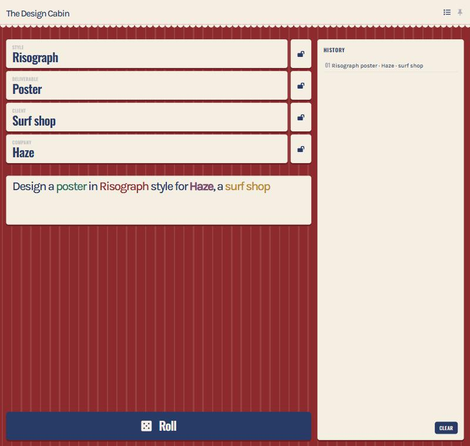
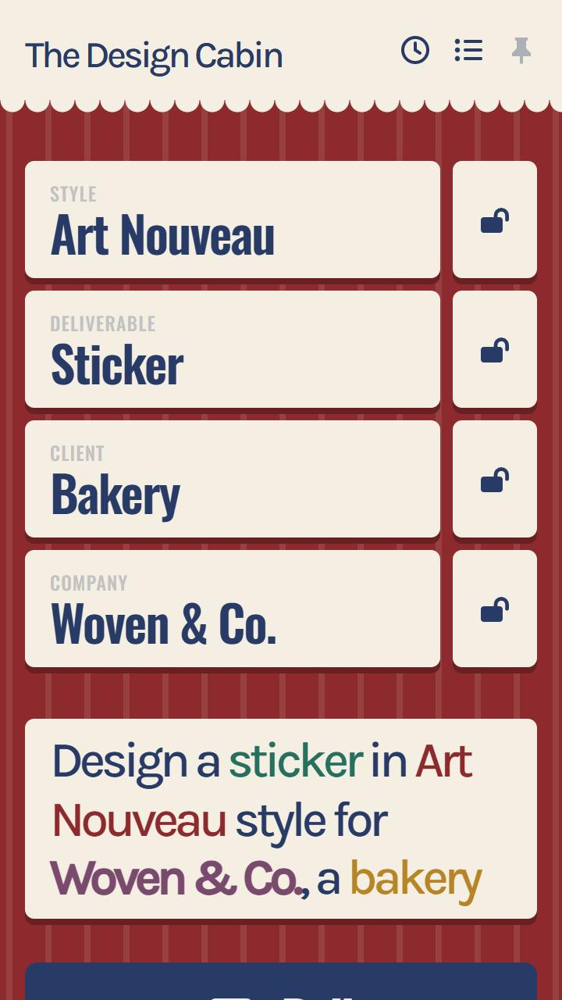
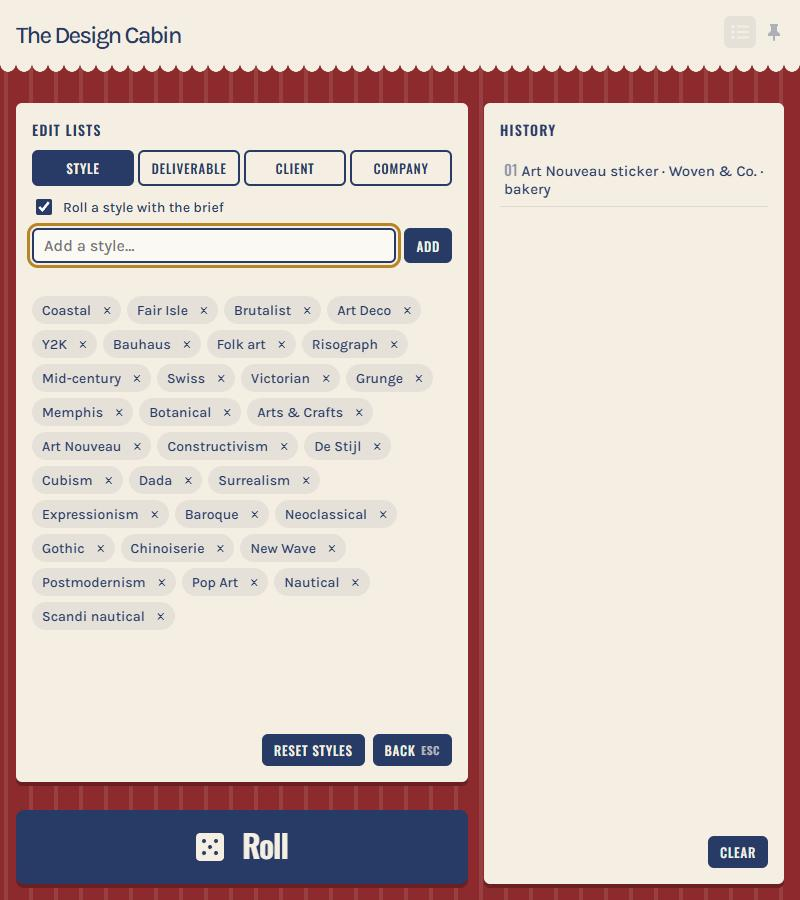

# Brief Roller

A tiny design-brief generator. Press Roll and get a random creative brief: a style, a deliverable, a client, and optionally a company name.

## How it works

- **Roll** fills every unlocked slot with a new value.
- **Lock** a slot (click its lock icon, or press `1`-`4`) to keep its value while you reroll the rest.
- Click the brief sentence, or press `C`, to copy it.
- **History** (`H`) keeps your last several rolls so you can go back to one.
- **Lists** (`E`) is where you manage what can be rolled:
  - Add or remove items in any list.
  - Reset a list to its defaults.
  - Switch Style, Client, or Company on or off. Deliverable always stays in the brief.
- **Pin** keeps the window on top of others (desktop app only).

 

## Slots

| Slot | Examples |
|---|---|
| Style | Art Deco, Bauhaus, Grunge |
| Deliverable | Poster, Logo, Tote bag (always included) |
| Client | Bakery, Arcade, Dentist |
| Company | Northlane, Lumen, Fable (on by default) |

## Keyboard shortcuts

| Key | Action |
|---|---|
| `1`-`4` | Lock or unlock that slot |
| `Space` | Roll |
| `C` | Copy the brief |
| `H` | Toggle history |
| `E` | Toggle Lists |
| `Esc` | Close the current panel |
